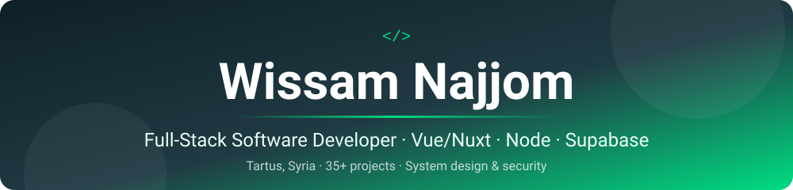

**مطوّر برمجيات Full-Stack من طرطوس، سوريا. أبني واجهات سريعة وأنظمة خلفية آمنة وتطبيقات متعددة المنصات.**

&nbsp;

    

## home

Full-stack developer from Tartus, Syria. I build web apps in Vue and Nuxt, and when a client wants their product on the desktop or the App Store I wrap the same codebase with Electron or Capacitor instead of starting over. On the backend it's Node, Express and Supabase, and the part I care most about is the unglamorous work: Postgres row-level security, auth architecture, realtime notification pipelines.

Three years of client work taught me something simple. A site that loads fast and handles Arabic and English properly beats a beautiful demo:

- 35+ shipped projects across e-commerce, e-learning, fintech and real estate, for clients in Syria and the Gulf, most reaching 90+ on Lighthouse
- Performance work that cut average page load by ~30%: code splitting, lazy loading, asset optimization, proper caching
- One codebase running as SPA, SSR or SSG, in Arabic (RTL) or English (LTR), with i18n done properly instead of bolted on
- PWA / offline support with Workbox when the client wants an installable app without a store
- 5 trainees mentored, structured code reviews, B.Sc. in Informatics Engineering, Tishreen University (2026)
- Daily AI tools: Claude, Gemini, DeepSeek. They speed me up, they don't decide the architecture

## KKit

**[KKit](https://github.com/wissam333/KKit)** is my flagship open-source project — a free serverless toolbox for the web, no backend, everything peer-to-peer. Installed features:

- [x] P2P video calls and screen sharing (WebRTC)
- [x] Live whiteboard and file chat (PeerJS)
- [x] Telegram power tools — GramKit (GramJS)
- [x] Multiplayer WW1 dogfight game on Canvas

Installable as a PWA, in Arabic and English, hosted on a Cloudflare Worker so it costs nothing to run.

`Nuxt 3` `Vue 3` `WebRTC` `PeerJS` `GramJS` `Canvas` &nbsp;→&nbsp;
 

## work

Client work, the kind I got paid for. Click a project to open its screen:

<b>Hamasat Perfumes</b> · online perfume store

&nbsp;

E-commerce storefront for a Syrian perfume house.

**Live:** [hamasatperfumes.com](https://hamasatperfumes.com/)

<b>Nerva Online</b> · marketing agency

&nbsp;

Agency site built with SSR, tuned for Core Web Vitals.

**Live:** [nerva-online.com](https://nerva-online.com/)

<b>Ask Med</b> · medical platform

&nbsp;

Doctor directory with appointment booking.

**Live:** [ask-med.net](https://ask-med.net/)

<b>Triathlon UAE</b> · sports portal

&nbsp;

Multilingual portal for a UAE triathlon federation.

**Live:** [triathlonuae.net](https://triathlonuae.net/)

<b>UAE Archery Federation</b> · federation site

&nbsp;

Site for the national archery federation.

**Live:** [uaearchery.net](https://uaearchery.net/)

<b>True Future</b> · real estate

&nbsp;

Real estate company site.

**Live:** [truefre.net](https://truefre.net/)

<b>Massar School</b> · school management system

&nbsp;

School management and education platform.

**Live:** [schooltec.org](https://schooltec.org/)

<b>Emarati Magazine</b> · e-magazine

&nbsp;

News and magazine publication.

**Live:** [emaratimagazine.com](https://emaratimagazine.com/)

More on my [portfolio](https://wissam-najjom.vercel.app/).

## stack

Also: Vuetify · PrimeVue · Pinia · @nuxtjs/i18n · PWA / Workbox · Capacitor · Supabase Auth / Realtime / Storage / RLS

## stats

## hire

I'm open to full-stack / Nuxt roles and freelance projects. If you have a web product that needs to be fast and secure, that speaks Arabic and English, or that needs to become a desktop or mobile app, that's exactly the kind of work I like.

status: open to offers · built by hand in Tartus, Syria · last updated November 2026

